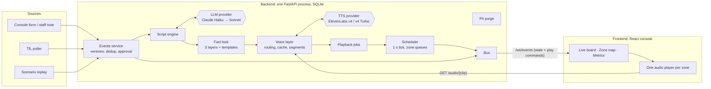

# Relay

**Context-aware PA announcements for transport hubs, voiced by ElevenLabs.**

Operational events go in: a Tube line delay, a passenger page, a bus stand change. Correct, on-brand, multilingual announcements come out, play in the right zones, repeat on schedule, escalate, and stop the moment the situation changes. An LLM writes the wording; a deterministic **fact lock** makes sure it never states a fact that is not in the event.

## The problem

Routine PA audio ("mind the gap") is pre-recorded, so anything situational is still read out by staff over a microphone. The results:

- **Inconsistent wording.** Every announcement depends on who is at the microphone.
- **Usually English-only.** A passenger who does not speak English misses the message.
- **Repeats are forgotten.** Staff have to remember to say it again.
- **Messages are not retracted.** "Severe delays" keeps being repeated after the line has recovered.

Plain text-to-speech fixes the voice but not the content: an LLM that writes "Gate 32" instead of "Gate 23" is worse than no announcement at all.

Relay closes both gaps:
- **The LLM writes the house style with placeholders**, and code fills in the facts.
- **The fact lock rejects any script that contains a fact the event does not have.** A rejected script gets one retry on a stronger model, and then a deterministic template.
- **ElevenLabs voices the script in each zone's languages**, with one brand voice in English, Spanish and French.
- **A scheduler repeats, escalates and retracts the announcement.** It caches by content, so a repeat costs nothing.

## Quickstart

With Docker (no keys needed, everything runs in mock mode):

```bash
git clone https://github.com/MohitthSM/Relay11Labs.git && cd Relay11Labs
docker compose up --build
```

Open <http://localhost:8080>, press **B · BA117**, then **Enable audio**.

Without Docker (needs `uv`, Node 22, and `ffmpeg` for live MP3 audio):

```bash
make setup
make dev
```

Open <http://localhost:5173>.

**To go live:** `cp .env.example .env` and set `ANTHROPIC_API_KEY` and/or `ELEVENLABS_API_KEY`. Each provider switches to live on its own when its key is present. The header always shows which providers are live (`LLM: live|mock · TTS: live|mock`).

## Running live locally (Claude and ElevenLabs)

The cloud environment this was built in can inject an ElevenLabs key but not an Anthropic key, so the Claude checks run on your machine. Keys go in `.env` only (git-ignored).

```bash
cp .env.example .env
```

Set `ANTHROPIC_API_KEY=` and `ELEVENLABS_API_KEY=` in `.env`. The repo-root `.env` and `backend/.env` both work; the backend one wins.

**Live smoke tests.** These are skipped unless `-m live` is passed and a key is set.

Claude only: one batched scenario B call on `claude-haiku-5-5` with structured output, about $0.001:

```bash
cd backend && uv run pytest -m live -q -k claude
```

Both providers. The ElevenLabs test bills one short clip, about 53 characters:

```bash
cd backend && uv run pytest -m live -q
```

**Samples with Claude-written scripts.** With `ANTHROPIC_API_KEY` set, `render_samples.py` takes its scripts from Claude: Haiku first, Sonnet on a fact-lock retry, and the template if both fail. Claude's wording differs from the templates, so the committed clips don't match and the plan shows new characters. Claude can also word a script differently on each run, so every run bills again. Keep them out of the committed set:

The plan (no audio is rendered: the script engine calls Claude, but nothing is sent to ElevenLabs):

```bash
cd backend && uv run python scripts/render_samples.py --out ../docs/samples-llm
```

Render, within your budget:

```bash
cd backend && uv run python scripts/render_samples.py --out ../docs/samples-llm --go --budget 5000
```

`report.md` in that folder says, per clip, whether the script came from `llm` or `template`, the characters billed and the time to first audio.

**Replaying the committed samples at zero cost.** The app seeds `docs/samples/` into its audio cache at start-up when TTS is live. Those clips were voiced from the template wording, so they are only reused while the LLM is in mock mode. Start the backend with:

```bash
RELAY_LLM_MODE=mock make dev
```

With Claude live, every new event gets fresh wording and is voiced (and billed) again.

## The demo (5 minutes)

| | Scenario | What it shows |
|---|---|---|
| A | Jubilee line: severe delays → minor delays → good service | An update replaces the old message within one tick. "Good service" plays twice, then silence. |
| B | Final call for BA117 in EN → ES → FR, 3 repeats | One voice across three languages. Urgency escalates. Turn **Hallucinate** on to watch the fact lock reject "Gate 32" and fall back to the template. |
| C | Route 25 moves from stand B to F | 7 plays from 1 render: the audio cache. |
| | **Metrics** page | Model routing, fact-lock rejections, characters billed vs saved, time to first audio. |
| | **Live (TfL)** toggle | The real Jubilee status from the TfL API. Switching back to Demo withdraws live announcements, so they never play over a script. |

## Architecture



**Mock mode:** every LLM and TTS call goes through a provider Protocol with a mock implementation, so the whole demo runs with no keys and no network. Details are in [ARCHITECTURE.md](ARCHITECTURE.md); what and why is in [SPEC.md](SPEC.md).

## Design decisions

The full list, with tradeoffs, is ARCHITECTURE §6 (D1–D23). The ones that matter most:

- **The LLM writes placeholders, never facts (D1).** `{gate}`, `{flight_number}` and `{passenger_name}` are filled in by code. Passenger names are never sent to the LLM (D16).
- **The fact lock is deterministic and layered.** It checks placeholders, digits and codes, number words, gazetteer names and a claim lexicon. Any violation means one retry on the escalation model, and then the template for that one language (D2, D3). Every miss becomes a test.
- **Every urgency level and language is rendered at ingest (D4).** Playback never waits on generation.
- **The audio cache is content-addressed (D5).** Fixed phrases are voiced once (D18), so repeats and identical events cost zero characters.
- **ElevenLabs model routing by urgency (D17).** `eleven_v4_turbo` (~100 ms) is used for what must play now. `eleven_v4` (highest quality) is used for escalation levels that are rendered ahead of time.
- **Replace, never stack (D21).** An update cancels the previous version's plays before new ones are scheduled. An identical event is a duplicate.
- **A human is in the loop for risky inputs (D20).** Staff notes and severe disruption wait for an operator's approval. Nothing is broadcast without a preview (D22).
- **Stale data never announces (D23).** If the TfL feed fails, Relay keeps the last state and says so. It never invents "good service".
- **Out of scope by design:** emergency, evacuation and security announcements. These stay pre-recorded and pre-approved.

## Costs

A bad weekday at one Tube station, 204 announcement plays, bills about **800 TTS characters ($0.03)**. Without the cache it would be 33,000 characters ($1.32). See [docs/COSTS.md](docs/COSTS.md); the simulation is reproducible with `scripts/simulate_day.py`.

## Project layout

```
backend/   FastAPI app (relay/), prompts, site configs, scenarios, scripts, tests
frontend/  React + Vite + Tailwind console
docs/      COSTS.md, REVIEW.md, samples/
```

| Command | What it does |
|---|---|
| `make test` | backend test suite (mock mode, about 30 s) |
| `make lint` | ruff, pyright, and the frontend typecheck |
| `make sync-pronunciations` | upload `sites/*.pls` to ElevenLabs, write the lock file |
| `cd backend && uv run python scripts/pick_voice.py` | shortlist voices for PA use from the voices API |
| `cd backend && uv run python scripts/render_samples.py` | real MP3s for scenarios A and B, plus the model comparison |

## Roadmap

- **ElevenLabs Agents at help points.** A passenger presses the help point after an announcement and asks a follow-up question ("Which line should I take instead?"). The agent is grounded in the same active events, so it has the same facts and the same fact lock.
- **Live captions on station screens.** Accessibility for deaf and hard-of-hearing passengers. The caption is the already-approved script, so the screen and the speaker never disagree.
- **Audio effects for a real PA sound:** a station-hall environment and a PA filter preset, set per site.
- **Pronunciation of passenger names.** An optional IPA field, inserted by code and never by the LLM.
- **Real PA hardware.** Hand play commands to SIP or Dante zone controllers instead of browser panels, with real play-completion acknowledgements.
- **More feeds.** Bus arrivals and a real flight-information feed: the `FlightFeed` seam is already there.
- **More languages.** Adding a language means adding its templates and claim lexicon; nothing else changes.
